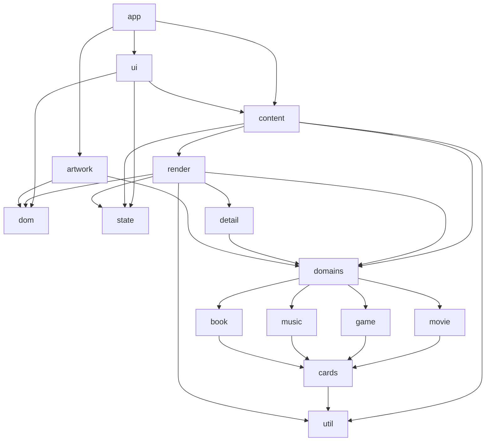

# Frontend modules — split `app.js` into ES modules

## Intent

`src/main/resources/movie-page/app.js` is one 514-line closure. The previous
slice gave it real seams (`DOMAINS`, `state`, `render()`, `loadContent()`,
card builders, `openDetail()`), so the next step is to let each seam live in its
own file with a declared interface. Files are the goal; the seam layout is
already correct.

The blocker is load mechanics, not code structure: the Krema shell serves the
page from a loopback HTTP server (`com.sun.net.httpserver`, `http://127.0.0.1:<port>`),
where ES modules load normally, but the JCEF shell extracts the same resources
to a temp dir and loads `file://…/index.html`, where Chromium refuses
`<script type="module">`. Splitting therefore requires changing how the JCEF
shell serves the page.

Success looks like: `app.js` becomes a file tree of small modules, both shells
load them unmodified, and nothing about the page's behavior or look changes.

## Goals

- Split the frontend into ES modules with explicit imports, one file per seam.
- One entry module (`js/app.js`) listed in `index.html` as
  `<script type="module">`.
- Both shells load the page the same way: over loopback HTTP, from the same
  resource tree.
- Delete the JCEF temp-extract + `injectShim` string-replace path, which breaks
  silently whenever the entry script tag is renamed.
- Keep the `window.krema` contract, card markup, CSS, and controller code
  untouched.

## Non-goals

- No framework, bundler, or build step; the resources stay plain files served
  as-is.
- No visual, layout, copy, or interaction changes. The previous slice's race
  fix, `openDetail` seam, and card shapes are preserved.
- No new views (detail page, My Lists, My Searches).
- No Java controller/command/event renames.

## Anti-goals

- Two different load paths (HTTP in one shell, `file://` in the other) that must
  both be maintained and debugged.
- A split that leaves `index.html` dependent on one exact script tag string so
  the shell's shim injection keeps working.
- Modules that reach back into each other in a cycle and only work because
  function bodies run late.

## Constraints

- Both shells must work: Krema (system webview) and JCEF (bundled Chromium).
- JCEF is currently loaded from `file://`; ES modules are blocked there.
- The JCEF bridge (`krema-shim.js`) must load before any page script uses
  `window.krema`, and must never clobber Krema's native bridge.
- Windows Krema constraint stays as-is: the drains remain synchronous
  UI-thread commands; nothing in this slice changes the IPC shape or cadence.
- `repos/krema` is read-only reference; `build.krema.core.AssetServer` is the
  public class the Krema shell already uses.

## Approaches

1. **Serve the JCEF page over loopback HTTP (chosen).** Start krema-core's
   `AssetServer("/movie-page")` in the JCEF shell and load
   `http://127.0.0.1:<port>/index.html`. Both shells then load identically, the
   temp-dir extract/inject code disappears, and the shim ships with the page
   instead of being injected at runtime. Cost: the shim moves into
   `movie-page/` and must guard itself, plus ~15 lines of shell setup.
2. **Keep `file://`, add CEF's `--allow-file-access-from-files`.** One builder
   argument, but it relaxes file-origin security and module loading from
   `file://` is not a supported path — it needs a spike to prove it on CEF 152,
   and the fallback is approach 1 anyway.
3. **Custom `app://` scheme handler.** Textbook-correct, no port bound, but it
   means implementing and registering a `CefSchemeHandlerFactory`, which is
   more CEF surface than this app needs.

Approach 1 was chosen because it removes more code than it adds and leaves both
shells on one load path.

## Design

### File layout

```
src/main/resources/movie-page/
  index.html            shim + module entry
  style.css             unchanged
  starry.png            unchanged
  posters/              unchanged
  krema-shim.js         moved here from src/main/resources/jcef/, guarded
  js/
    app.js              entry: subscribe artwork, seed the initial load
    dom.js              element lookups for the page shell
    util.js             escapeHtml, messageOf, posterFailed
    state.js            state object, request sequence helpers
    cards.js            baseCard, wireCard, posterCard (take the row as a parameter)
    domains/
      movie.js          movie row: portrait card + detail
      game.js           game row: portrait card + detail
      music.js          music row: album card + detail
      book.js           book row: book card + detail
      poster-detail.js  the detail text movie and game share
    domains.js          DOMAINS registry assembled from the four rows
    artwork.js          artwork subscriptions + setArtwork
    detail.js           openDetail (the detail-view slice replaces this file)
    render.js           render / renderBrowse / cards / empty / skeleton
    content.js          loadContent + data and artwork drains
    ui.js               search box + custom filter dropdown wiring
```

One level of `domains/` grouping because those four files are the ones that grow
(one per content form) and a new form is "add a row + a file".

### Dependency direction



Edges point one way; no module imports its importer. The one place the old code
would have created a cycle is card clicks: `cards.js` must not import
`detail.js`, because `detail.js` reads `DOMAINS` and the domain rows import
`cards.js`. Cards therefore take the open handler as a parameter
(`card(item, idx, onOpen)`), and `render.js` passes `openDetail` in. That keeps
the click-to-open policy in one visible place and stops domain modules from
knowing about the alert.

The same rule applies to the shared builders: `baseCard`/`posterCard` need the
card class and id field, which live on the row itself, so the row is passed in —
`baseCard(row, item, idx)` — instead of `cards.js` importing `DOMAINS` to look
the row up. Each row passes itself (its own exported const) to the builder, so
`cards.js` knows nothing about which forms exist. Rows also carry their own
`key`, which is what makes `data-<key>-id` derivable without a separate
domainKey argument and lets `domains.js` assemble the registry from the rows.

### Module contracts

```js
// state.js
export const state = { view, domain, title, status, items, error };
export function nextRequest();        // ++requestSeq
export function isCurrent(seq);       // seq === requestSeq

// domains/<name>.js
export const movieDomain = {
    key: "movie",                 // also the data-<key>-id dataset prefix
    request, data, art, event,
    plural, emptyLabel,
    cardClass, artClass, idField,
    card(item, idx, onOpen),
    detail(item) -> { title, body },
};

// domains.js
export const DOMAINS = Object.fromEntries(
    [movieDomain, gameDomain, musicDomain, bookDomain].map((d) => [d.key, d]));
export const DOMAIN_KEYS = Object.keys(DOMAINS);

// render.js
export function render();

// content.js
export async function loadContent(domainKey, kind, term);

// artwork.js
export function subscribeArtwork();
export function setArtwork(domainKey, id, dataUri);

// detail.js
export function openDetail(domainKey, item);

// ui.js            wiring runs on import (module executes after parse)
// app.js           imports ui, subscribes artwork, calls loadContent("movie", "trending", "")
```

Module scripts execute after HTML parsing, so `dom.js` can look elements up at
module top level; the `DOMContentLoaded` wrapper disappears. No top-level
`await` is used — the seed load is fired and left to its own error handling,
which `loadContent` already does.

### `index.html`

```html
<script src="krema-shim.js"></script>
<script type="module" src="js/app.js"></script>
```

The shim stays a classic script (CEF's `cefQuery` API is not module-based) and
runs during parse, so it is always ready before the deferred module executes.

### Shim move and guard

`src/main/resources/jcef/krema-shim.js` moves to
`src/main/resources/movie-page/krema-shim.js` and starts with:

```js
if (window.krema && typeof window.krema.invoke === "function") return;  // Krema shell
```

Krema registers its bridge through `webview_init` (`IpcHandler.initialize()`,
called from `KremaApplication` at line 186, before the `window.navigate(...)`
at line 249), so `window.krema` exists before any page script in that shell and
the shim is inert there. In JCEF nothing defines `window.krema` first, so the
shim installs its `cefQuery` implementation. The existing runtime
`typeof window.cefQuery === "function"` check inside `invoke` stays.

`AssetServer` is public in `build.krema.core` (krema-core is already a compile
dependency) and resolves resources through its own class loader, so
`/movie-page/…` works both from `target/classes` and from a packaged jar.

### JCEF shell

`JcefVanGoghApp`:

- Start `new AssetServer("/movie-page")` (krema-core, already a dependency),
  call `start()`, and load `server.getUrl() + "/index.html"` into the browser.
- Register a shutdown hook that closes the server (the window's
  `windowClosing` already calls `System.exit(0)`, so hooks run).
- Delete `extractResources`, `copyTree`, `injectShim`, `SHIM_RESOURCE`, and the
  imports only they used (`File`, `InputStream`, `URL`, `URLDecoder`, `Files`,
  `Path`, `StandardCopyOption`, `Enumeration`, `JarEntry`, `JarFile`,
  `FileNotFoundException`). `RESOURCE_PREFIX` becomes the asset server path.
- Update the class Javadoc: the page is served over loopback HTTP, the shim
  ships with the page.

`src/main/resources/jcef/` ends up empty and is removed.

## Delivery

- New branch `feat/frontend-modules`, stacked on `feat/frontend-architecture`
  (that branch rewrote the file this slice splits). Retarget after the stack
  lands.
- One commit for the split; AGENTS.md and `architecture.md` updated in the same
  commit because both currently describe `app.js` as a single script.
- The vault copy of the project description
  (`10 Projects/VanGogh/description.md`) follows AGENTS.md, as the repo rule
  says; flagged to the user rather than edited silently.

## Verification

- Syntax: `node --check` every module (Node 22, module mode).
- `mvn -q test` — 108 tests, no Java behavior changes.
- Mock harness outside the repo (temp dir, not committed): the real
  `index.html`, `style.css`, and `js/` tree, with a classic `mock-krema.js`
  loaded before the entry module and a stub `krema-shim.js` in place (it no-ops
  without `cefQuery`). Served over HTTP by `python3 -m http.server`, driven in
  the in-app browser:
  - initial trending movies; skeleton grid first;
  - all four filters (movie, music, game, book) with their card shapes;
  - Enter-to-search;
  - Movie → Music switch with the movie reply delayed: album rows must never be
    replaced by movie rows, and the movie reply must go undrained;
  - one card detail per form.
- Real shells:
  - Krema: `mvn compile exec:exec` — page loads, trending renders, filter and
    search work, artwork streams, shim is inert.
  - JCEF: `mvn compile exec:exec -Pjcef` — page loads over the loopback URL,
    the **shim bridges** (`window.krema.invoke` resolves through `cefQuery`),
    trending renders, artwork streams. This is the run that proves the guard
    and the new load path.
- `mvn -q clean compile` before committing.

## Outcome (2026-11-17, built on this branch)

- 16 modules, all parse (`node --input-type=module --check`); `mvn test` 108/108.
- Mock harness (HTTP, mock bridge loaded before the shim): initial trending,
  four filters, Enter search, both detail texts, skeletons, artwork. The shim
  stayed inert (`window.cefQuery` absent) — the guard path.
- Movie → Music with a 2.5 s movie delay: album rows stayed, `data-movie-id`
  cards 0, and the mock reported the movie reply still undrained — the race
  guard survived the split.
- JCEF shell driven over the CEF remote-debugging port
  (`VANGOGH_CEF_DEBUG_PORT=9222`): page served from
  `http://127.0.0.1:51181`, `window.krema.invoke` alive through the shim,
  19 trending movie cards with 19 posters, and 11 album cards after switching
  the filter — the new load path and the shim guard both hold against the real
  backend.
- Krema shell: same page over its own asset server; verified by launch (the
  shim no-ops there because the native bridge exists before page scripts).
